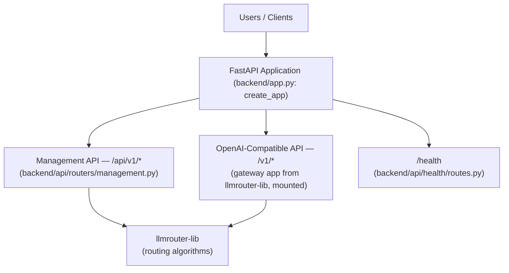
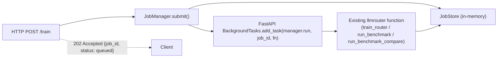

# Backend Architecture

This document describes the backend as built and verified. See also `docs/design.md`.

## One Deployable, Two API Surfaces

`backend/` is the single app host: it owns configuration, logging, middleware, error handling,
health, and the job system. It does not reimplement any routing, training, or evaluation logic —
every `/api/v1/*` handler is a thin wrapper that imports and calls an existing `llmrouter` function
(`load_router`, `route_query`, `infer_query`, `train_router`) or, for benchmarking, a small
orchestration service (`backend/api/services/benchmark.py`) that itself calls those same
functions plus reads each router's existing `routing_data_test`.

**Why mounting, not merging source.** The gateway's `create_app()` returns a complete `FastAPI`
instance with routes registered via decorators directly on that instance — there's no
`APIRouter` to `include_router()` without editing the gateway's source. FastAPI's
`app.mount(path, other_app)` composes two ASGI applications into one server process without
requiring either one's registration code to change. From any external client's perspective (one
TCP port, one process) this is a single backend, even though two `FastAPI()` objects exist
internally. The one confirmed limitation: Starlette does not merge a mounted sub-application's
routes into the parent's `/openapi.json` — the gateway's own `/v1/*` routes are reachable
and functional (verified: `tests/test_openai_compat.py`) but won't appear in Swagger
`/docs` alongside `/api/v1/*`. Documented here rather than worked around, since fixing it would
mean either duplicating the gateway's route definitions or patching its source — both
excluded by the "must not be rewritten" constraint.

**Why `/health` is registered before the mount.** Starlette checks routes in the order they were
added. The gateway defines its own `/health` (returning `{"status", "strategy", "llms"}`).
Registering the backend's own minimal `/health` (`{"status": "ok"}`) via `app.include_router()`
*before* `app.mount("", gateway_app)` makes it win for that exact path — verified in
`tests/test_openai_compat.py::test_root_health_is_backends_not_the_gateways`.

## Request-Handling Stack

Every request through either surface passes through the same stack, built up in
`backend/app.py::create_app()`:

1. **CORS** (`CORSMiddleware`) — outermost, so preflight `OPTIONS` requests are handled before
   anything else. Currently permissive (`allow_origins=["*"]`) — no auth exists yet to scope it
   against (see Limitations).
2. **GZip** (`GZipMiddleware`, `minimum_size=1000`) — compresses responses over 1KB.
3. **Request logging + timing** (`RequestLoggingMiddleware`,
   `backend/api/middleware/request_logging.py`) — innermost middleware, so its timing is the most
   accurate. Assigns a `uuid.uuid4()` request ID, stores it in a `contextvars.ContextVar`
   (`request_id_var`) so it threads through nested calls including background jobs, and adds
   `X-Request-ID`/`X-Execution-Time` response headers.
4. **Route handling** — either an `/api/v1/*` management endpoint or a mounted the gateway
   route.
5. **Exception handlers** (`backend/api/exceptions/handlers.py`, registered at app level, not
   middleware) — three handlers (`StarletteHTTPException`, `RequestValidationError`, catch-all
   `Exception`) all return the same `{error, error_type, request_id}` shape. The catch-all logs
   the full traceback server-side (`exc_info=True`) and never includes it in the response.

Structured JSON logging (`backend/api/middleware/logging_context.py::configure_logging`) replaces
the root logger's handlers with a `JSONFormatter` that includes the current `request_id_var` value
in every log line — this is why some tests use `capsys` instead of pytest's `caplog` fixture (see
"Known Test-Design Note" below).

## Async Job System

Long-running operations (`train`, `benchmark`, `benchmark/compare`) must never block the HTTP
request. All three follow the same pattern:

- **`Job`** (`backend/api/services/jobs.py`) — a dataclass: `job_id`, `job_type`, `status`,
  `created_at`, `started_at`, `completed_at`, `progress`, `result`, `error`.
- **`JobStatus`** — `queued → running → (completed | failed | cancelled)`.
- **`JobStore`** — a `typing.Protocol` (`create`/`get`/`update`/`list`), not an abstract base
  class, so a future Redis-backed store needs only matching methods, not inheritance.
- **`InMemoryJobStore`** — the only implementation in Phase 3, explicitly: no Redis, Celery,
  RabbitMQ, Kafka, or PostgreSQL yet. This means job state does not survive a process restart and
  is not shared across multiple backend instances — acceptable for Phase 3's single-deployable
  scope, called out explicitly as Phase 4 scope below.
- **`JobManager`** — `submit(job_type, fn) -> Job` (called synchronously in the request handler,
  returns immediately) and `run(job_id, fn) -> None` (called by `BackgroundTasks`, never inline).
  `run()` catches all exceptions, stores only `str(exc)` on the job (never a traceback), and logs
  the full traceback via a private `_log_traceback` helper — the same
  visible-to-client-vs-logged-server-side split used by the exception handlers.

Because every endpoint returns the same `{job_id, status}` shape regardless of what's actually
executing the job, Phase 4 can swap `InMemoryJobStore` for a Redis/Celery-backed implementation
behind the `JobStore` protocol without any client-visible API change.

## Configuration

`backend/config.py::BackendConfig` — a dataclass with `from_env()` reading `BACKEND_HOST`,
`BACKEND_PORT`, `BACKEND_LOG_LEVEL`, `BACKEND_GATEWAY_CONFIG` (which gateway config
file to mount). No secrets management beyond what the gateway's own config already does
(`${ENV_VAR}` substitution for API keys in YAML).

## Known Limitations (Explicit Phase 4 Candidates)

- No authentication/authorization — every `/api/v1/*` and `/v1/*` route is unauthenticated.
  CORS's current `allow_origins=["*"]` should be tightened alongside adding auth, not before.
- In-memory job store only — job history is lost on restart; doesn't scale past one process.
- Mounted sub-app routes absent from the unified OpenAPI schema (see above) — a client relying
  solely on `/openapi.json`/generated SDKs won't discover `/v1/*` routes that way.
- No rate limiting, no request size limits beyond FastAPI/Starlette defaults.
- `/api/v1/metrics` reuses `scripts/repo_metrics.py`, which walks the filesystem/git history on
  every call rather than caching — fine for occasional use, not designed for polling.

## Known Test-Design Note

`configure_logging()` replaces the root logger's handlers (`root.handlers = [handler]`), which
also removes pytest's own `caplog` handler. Tests asserting on backend log output
(`tests/test_middleware.py::test_lifespan_logs_startup_and_shutdown`) use the `capsys`
fixture against the actual stderr stream instead of `caplog`.
