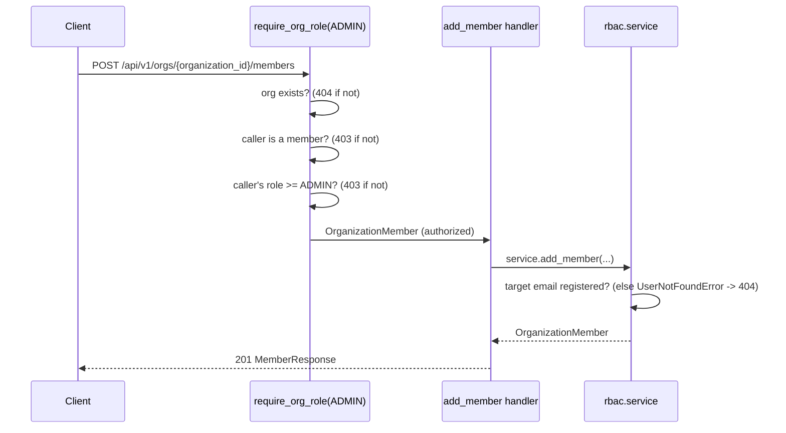

# RBAC: Organizations, Projects, Roles

**Status:** Phase 4, Milestone 3. Builds on `docs/backend/authentication.md`'s identity layer.

## Model

- **Organization** — the billing/plan boundary (`plan: free | developer | enterprise`, consumed
  starting Milestone 6's rate-limit plan tiers). Has a globally unique `slug`, auto-generated from
  `name` at creation (`_slugify` + a numeric suffix on collision, e.g. `acme-corp`, `acme-corp-2`).
- **OrganizationMember** — join table between `users` and `organizations`, carrying a `role`.
  `unique(organization_id, user_id)` — one role per person per organization; a person can belong
  to multiple organizations with different roles in each.
- **Project** — the operational boundary underneath an organization. Slug unique *within* its
  organization (`unique(organization_id, slug)`), not globally — two different organizations can
  each have a project called "core".
- **`api_keys.project_id`** — added nullable in this milestone's migration. Keys created in
  Milestone 2 (before `projects` existed) have no project and keep working unscoped; new keys
  should set one. Enforcing `NOT NULL` is a candidate for a later migration once every existing
  key is backfilled.

## Roles

A single linear hierarchy (`backend/api/rbac/roles.py`), not an independent-capability/permission
matrix — the spec's four roles nest ("Owner can do everything Admin can, plus more"), so
`meets_minimum(actual, minimum)` comparing numeric ranks is sufficient:

```
OWNER (4) > ADMIN (3) > DEVELOPER (2) > VIEWER (1)
```

| Action | Minimum role |
|---|---|
| View organization / list members / list projects / view a project | Viewer |
| Create a project | Developer |
| Add a member, remove a member, delete a project | Admin |
| Change a member's role | Owner |
| Create an organization | (any authenticated user — they become its first Owner) |

**Last-owner guard:** `change_member_role` and `remove_member` both reject an action that would
leave an organization with zero owners (`LastOwnerError` → `409 Conflict`) — verified in
`tests/test_rbac.py::test_cannot_demote_last_owner` and `::test_cannot_remove_last_owner`.

## Enforcement: Dependencies, Not Literal Middleware

The spec calls for "middleware" enforcing permissions. True ASGI middleware runs *before* routing
resolves path parameters, so it has no way to know which `organization_id`/`project_id` a request
targets without re-implementing routing itself. FastAPI's own recommended mechanism for
per-resource authorization is dependency injection bound to a path parameter — that's what
`backend/api/rbac/dependencies.py` implements (`require_org_role(minimum)` /
`require_project_role(minimum)`), the same kind of pragmatic, explicitly-flagged interpretation
Phase 3 used for "one FastAPI application" via `app.mount()`.

Every route in `backend/api/routers/organizations.py` that needs a permission check depends on one
of these — it is the *only* place a role is checked; `backend/api/rbac/service.py`'s functions
assume the caller was already authorized and only check resource existence and domain invariants
(last-owner). This split (enforcement in the dependency, business logic in the service) avoids
checking the same permission twice, and mirrors `backend/api/auth/`'s own
service-raises-domain-exceptions / route-translates-to-HTTP split.



## Endpoints

All under `/api/v1`, all requiring a JWT (`get_current_user` — API-key access to these routes is
not yet wired in; see `docs/backend/authentication.md`'s note on `get_current_principal` being
unused so far).

| Method | Path | Minimum role |
|---|---|---|
| POST | `/orgs` | none (creator becomes Owner) |
| GET | `/orgs` | none (lists only the caller's own) |
| GET | `/orgs/{organization_id}` | Viewer |
| GET | `/orgs/{organization_id}/members` | Viewer |
| POST | `/orgs/{organization_id}/members` | Admin |
| PATCH | `/orgs/{organization_id}/members/{user_id}` | Owner |
| DELETE | `/orgs/{organization_id}/members/{user_id}` | Admin |
| POST | `/orgs/{organization_id}/projects` | Developer |
| GET | `/orgs/{organization_id}/projects` | Viewer |
| GET | `/projects/{project_id}` | Viewer (of the owning organization) |
| DELETE | `/projects/{project_id}` | Admin (of the owning organization) |

**Adding a member requires the target to already be a registered user** (looked up by email) —
there is no invitation-by-email-to-a-nonexistent-account flow in Phase 4; that would need the
email infrastructure this phase deliberately stubs (see `docs/backend/authentication.md`'s Email
Verification section). Returns `404` if no user with that email exists.

## Database

Migration `61c85b2c669f` — see its own docstring for rollback notes and
`docs/design.md`'s Database Schema section for the full ERD.

## Testing

- `tests/test_roles.py` — unit tests for the role hierarchy, no database.
- `tests/test_rbac.py` — integration tests against the real dev Postgres container,
  covering the full organization/membership/project lifecycle and every permission boundary
  (viewer can't add members, developer can't change roles, non-owner can't demote/remove the last
  owner, non-member gets 403 not 404 leakage on detail routes, outsider can't see a project).
  **Note:** unlike `test_auth.py`'s per-test unique emails, organization *names* also had to become
  per-test-unique (`_unique_org_name`) after a real flake was caught during this milestone: fixed
  names like `"Acme Corp"` collided with organizations created by earlier runs against the same
  persistent dev database, making slug-suffix assertions (`"acme-corp-5"` instead of `"acme-corp"`)
  depend on test history. Fixed by generating a unique name per test run and computing the expected
  slug from it, rather than asserting a literal string.
