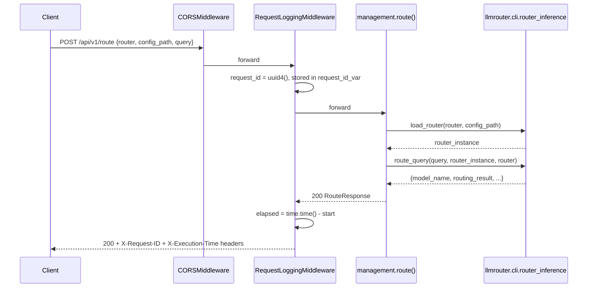
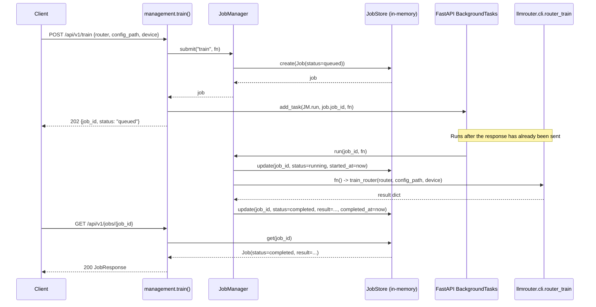
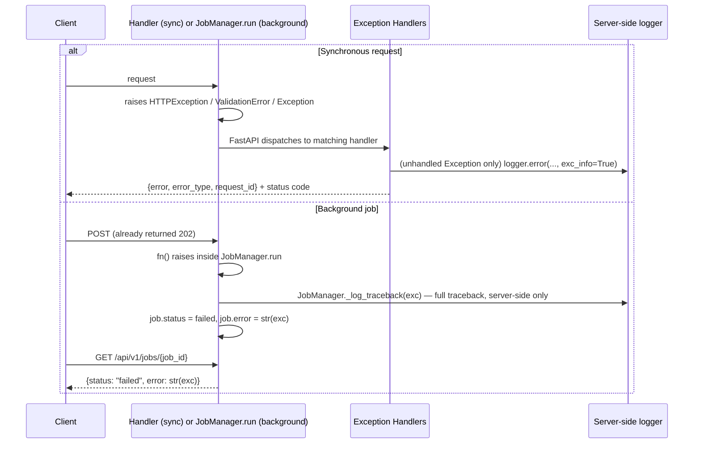

# Backend Request Lifecycle

Companion to `docs/backend/architecture.md`. Three sequences: a synchronous management request,
an asynchronous background job, and the error path. All three pass through the same middleware
stack described there (CORS → GZip → request logging/timing → handler → exception handlers).

## 1. Synchronous Request (e.g. `POST /api/v1/route`)

The handler never touches middleware or job machinery directly — it is exactly the two existing
library calls (`load_router`, `route_query`) wrapped in a Pydantic request/response pair.

## 2. Background Job (e.g. `POST /api/v1/train`)

The client receives `202` before `train_router` ever runs — polling `GET /api/v1/jobs/{job_id}`
is the only way to observe completion. `benchmark` and `benchmark/compare` follow the identical
shape, substituting `run_benchmark`/`run_benchmark_compare` for `train_router`.

## 3. Error Path (any endpoint, sync or inside a job)

Both paths share one invariant, verified by
`tests/test_error_handling.py::test_unhandled_exception_never_leaks_traceback`: a client
never receives a traceback or file path, only a short string. The full exception detail exists
exactly once — in the server-side log — correlated to the failing request/job via the same
`request_id` (synchronous path) or `job_id` (background path).
