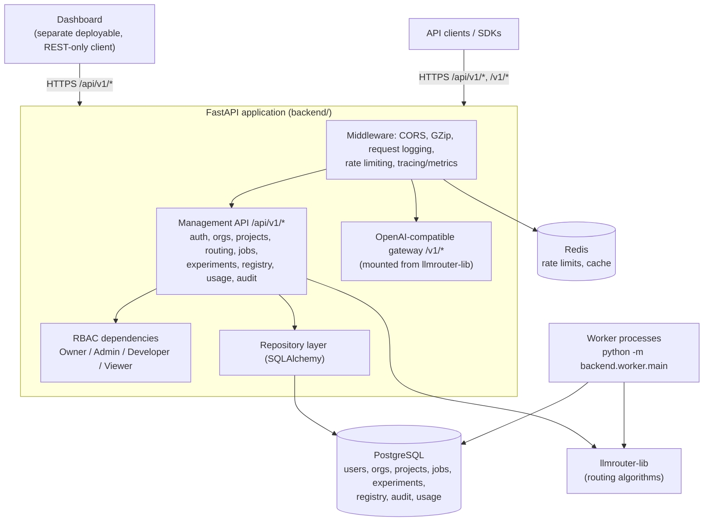
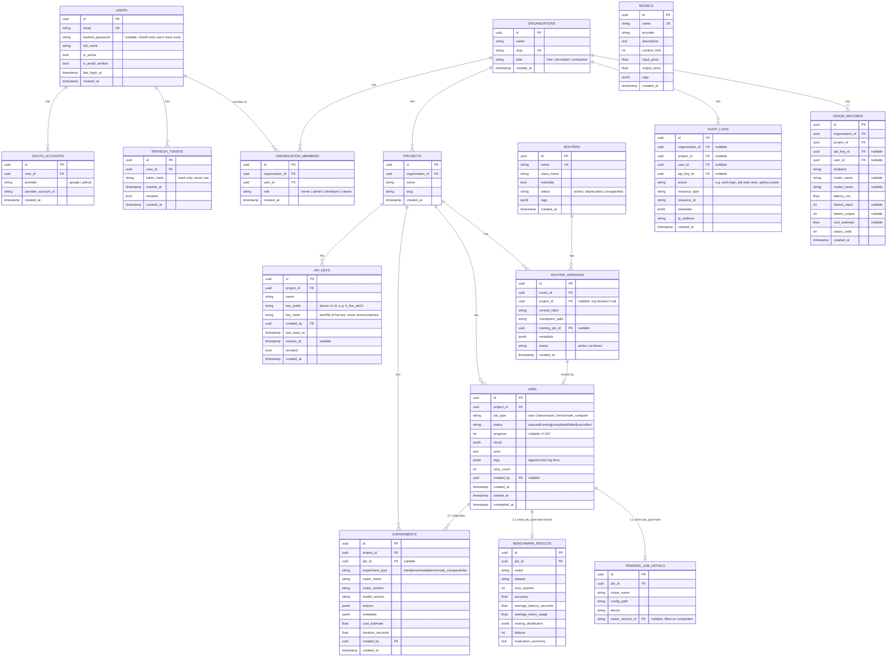

# LLMRouter Platform — Design

A multi-tenant platform for training, serving and operating LLM routers. The routing algorithms
come from the published `llmrouter-lib` package; this repository adds everything needed to run
them as a product: accounts and tenancy, access control, quotas, a durable job queue, experiment
tracking, a model registry, usage analytics, audit logs and observability.

It is a **modular monolith**: one FastAPI application, one deployable (plus the worker processes
that run background jobs), PostgreSQL as the system of record and Redis for short-lived state.

## Architecture

Training and benchmark requests only enqueue a row in `jobs`; separate worker processes claim and
run them (see `docs/backend/job_queue.md`).

**Why PostgreSQL and Redis both.** Redis holds short-lived, high-write data that does not need
durability (rate-limit counters, caches). PostgreSQL holds everything that must survive a restart
and be queried relationally (users, orgs, jobs, experiments, audit trail).

**Router configs and paths.** Router YAML files reference data and checkpoints with relative
paths. The library resolves those against its own install directory, so
`backend/api/services/config_resolver.py` rewrites them to absolute paths under the platform root
(`PLATFORM_ROOT`, default: the project directory) before handing the config to the library.

**Conventions.** Every schema change is an Alembic migration with a tested `downgrade()`. Database
access goes through repository classes. Auxiliary bookkeeping (experiments, usage, audit) is
isolated so a failure there never fails the request or job that triggered it. Existing
unauthenticated routing endpoints stay usable; sending a project-scoped API key additionally
attributes the call to a project for tracking, usage and rate limiting.

## Database Schema

All tables use a UUID primary key (`id`) unless noted. All tables get `created_at`; tables that
are mutated after creation also get `updated_at`. Managed entirely through Alembic migrations
(the initial migration creates the first tables; every later change to a table adds
its own migration — no hand-edited schema).

**Why `jobs` stays generic and `training_job_details`/`benchmark_results` are separate tables.**
The existing `Job` dataclass (the original) is already generic across `train`/`benchmark`/
`benchmark_compare` — it doesn't know what it's running, only its lifecycle. Keeping that
contract at the database level (one `jobs` table, one `JobStore` implementation) means
`JobManager` still doesn't need to know about routers or benchmarks. `training_job_details` and
`benchmark_results` hold the domain-specific fields the platform needs to query/aggregate that
don't belong on the generic envelope — mirroring the same separation of concerns as
`backend/api/services/benchmark.py` (orchestration) vs. `backend/api/services/jobs.py` (generic
execution) in the original.

## Authentication Model

Two independent client types authenticate differently, both terminating in the same
`get_current_principal` FastAPI dependency used by every protected route:

1. **Human users (dashboard, interactive API use)** — email+password or OAuth (Google/GitHub),
   issued a short-lived **JWT access token** (≈15 min) and a longer-lived **refresh token**
   (≈30 days, stored hashed in `refresh_tokens`, rotated on use). Access tokens are stateless
   (verified by signature, not a DB lookup) so they impose no per-request DB cost; refresh tokens
   are checked against the DB specifically so they can be revoked (logout, password reset,
   suspected compromise).
2. **Programmatic/API clients** — an **API key** (`lr_live_<random>` format), scoped to exactly
   one project. The full key is shown once at creation time and never stored — only
   `sha256(key)` and a short `key_prefix` (for display/identification) are persisted. Every
   request presenting an API key looks up by hash, checks `revoked`/`expires_at`, and updates
   `last_used_at`.

**Password hashing:** `passlib`'s `bcrypt` scheme (industry-standard, self-salting, adjustable
work factor) — never a custom hash.

**OAuth (Google, GitHub):** standard authorization-code flow. On callback, the backend exchanges
the code for the provider's profile (email, provider account ID), links or creates a `User` +
`OAuthAccount` row, and issues the same JWT/refresh-token pair as password login — OAuth users are
otherwise indistinguishable from password users to the rest of the system.

**Password reset:** time-limited, single-use signed token (same JWT-signing infrastructure, short
TTL, a dedicated `purpose: password_reset` claim so a leaked reset token can't be replayed as a
login token) emailed to the user.

**Email verification:** **stub only** in this platform, per the approved spec — the interface
(`EmailSender` protocol + a `ConsoleEmailSender` implementation that logs instead of sending) is
built so a real provider (SES, Postmark, etc.) can be swapped in later without changing the
verification flow's calling code.

**Session management:** "session" here means the refresh-token lifecycle above, not
server-side session state — no server-side session store is needed beyond the `refresh_tokens`
table, keeping the backend itself stateless between requests (any instance can validate any
access token).

## User Model

A `User` is a person, not scoped to any organization by itself — a `User` becomes a member of one
or more `Organization`s via `OrganizationMember` rows, each carrying its own `role`. This lets one
person belong to multiple organizations with different roles in each (e.g. Owner of their own org,
Viewer on a client's), which is standard SaaS multi-tenancy shape and matches "Organizations,
Users" being listed as separate top-level entities in the spec rather than users nesting inside
one organization.

## Organization Model

`Organization` is the billing/plan boundary (`plan: free | developer | enterprise`, consumed by
the rate-limit plan tiers). `Project` is the operational boundary underneath it — API
keys, jobs, experiments, and router versions all belong to a `Project`, not directly to an
`Organization`, so a single organization can isolate different workloads (e.g. "staging" vs
"production" projects) with separate API keys and separate job/experiment history while still
rolling up to one plan and one set of members for billing and access control.

